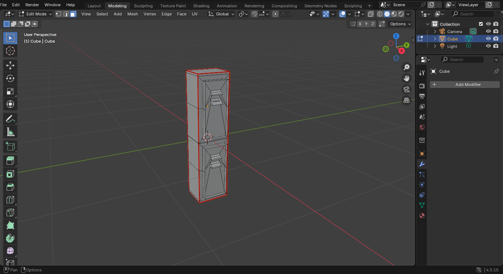

# Rusty School Locker: Blender Modeling & UV Unwrapping

A beginner-friendly, low-poly school locker modeled and UV unwrapped in **Blender 5.3**. This repository covers part 1: modeling and unwrapping. Texture painting (rust materials) follows in part 2.

## Overview

| Item | Detail |
|---|---|
| Software | Blender 5.3 |
| Skill level | Beginner (basic Blender knowledge needed) |
| Approach | Model the top half, duplicate it for the bottom, then unwrap using seams |
| Real-world size | About 1.8 m tall (modeled as two 0.9 m halves) |
| Status | Part 1 complete (modeling and UVs) |

## Repository Contents

| File | Description |
|---|---|
| `README.md` | Project documentation and workflow |
| `myfirstlocker.blend` | The Blender project file |
| `myfirstlocker.png` | Preview image of the finished model |
| `uv-layout.png` | UV layout screenshot |
| `.gitignore` | Ignores Blender backup files (`.blend1`, `.blend2`) |

## How to Open the Project

1. Install [Blender](https://www.blender.org/download/) (5.3 or newer recommended).
2. Download or clone this repository.
3. Open `myfirstlocker.blend` in Blender.
4. Switch to the **UV Editing** workspace to view the unwrap.

## Workflow

### Step 1: Blockout

1. Start with the default cube.
2. Open the side panel (`N` > Item) and set the dimensions for **half** the locker: **X 0.36, Y 0.46, Z 0.9**.
3. **Apply scale** (`Ctrl+A` > Scale). Without this, insets and bevels distort because of the non-uniform scale.

### Step 2: Door detail

1. In Edit Mode (`Tab`) and Face mode, select the front face.
2. **Inset** (`I`), then **Extrude** (`E`) outward to form the door. Adjust with `G` `Y`.
3. Inset again and extrude **inward** slightly to create the recessed door panel.

### Step 3: Vents

1. **Loop cut** across the middle (`Ctrl+R`, click, then right-click to cancel the slide).
2. Select the two faces and **inset individually** (`I`, then `I` again).
3. Scale on Z (`S` `Z`) and move them up (`G` `Z`).
4. The middle edge gets in the way. Since the surface is flat (planar), remove it with **Dissolve Edges** (not Delete, which would leave a hole).
5. Extrude the vent faces outward, then select the top edges and pull them back (`G` `Y`) and down (`G` `Z`) to create the angled slats.
6. Clean up the thin triangle by sliding an edge loop (`Alt+Click`, `G` `Z`).
7. Optionally, in Vertex mode (`1`), join vertices with `J` to preview the triangulation a game engine will produce.

### Step 4: Duplicate and join

1. Select all in **Edit Mode** (not Object Mode, so it stays one object).
2. Duplicate (`Shift+D`) along Z and move the copy
